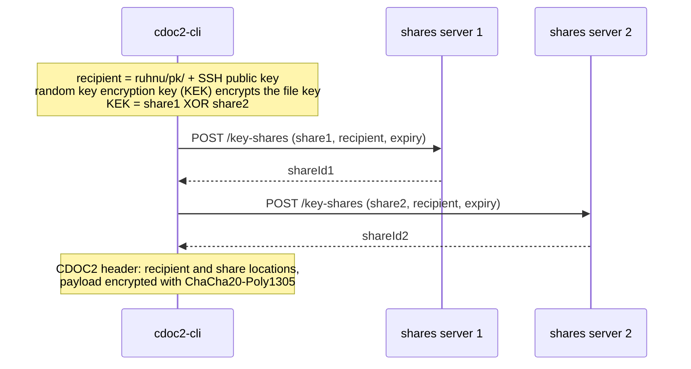
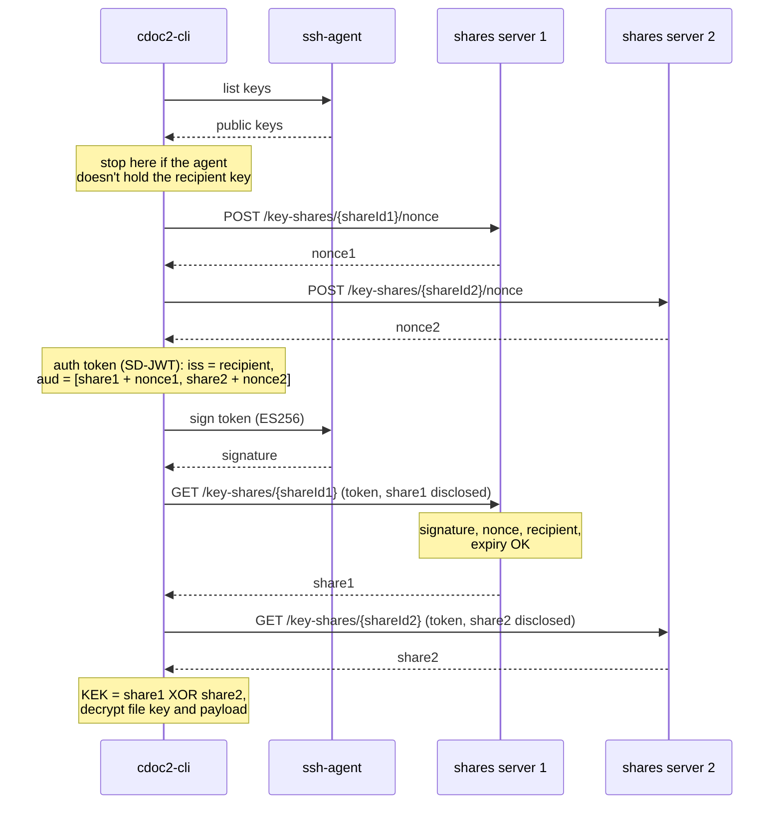

# Ruhnu

Experimental work on **revocable, audited access to secrets stored in Git** — including
secrets in commits already written — using the SSH keys engineers already have.

Built on [CDOC2](https://open-eid.github.io/CDOC2/2.0), the Estonian encrypted document
format. CDOC2's key-shares scheme splits key material across several servers, so that no
single server can decrypt anything on its own. An ssh-agent can sign but not decrypt — the
same constraint the scheme was designed around for Smart-ID — so the scheme carries over
with the signature coming from an SSH key instead.

## Why Ruhnu

Ruhnu is Estonia's most remote inhabited island. Key shares are held on separate servers,
each fragment useless by itself. One island is not the archipelago.

## How it works

The recipient is an SSH public key (ECDSA P-256 for now). It is written into the encrypted file as
`ruhnu/pk/<base64 OpenSSH public key>`, so the shares servers can check signatures against the key itself,
with no certificates and no key registry.

**Encrypting.** `cdoc2-cli` encrypts the file with a random key, splits that key into shares (all of them are
needed to rebuild it) and stores one share on each shares server, marked with the recipient's public key and
an expiry time.

**Decrypting.** `cdoc2-cli` asks every shares server for a nonce, builds one auth token naming all shares and
nonces, and has `ssh-agent` sign it with the private key, which never leaves the agent. Each server gets the
token with only its own share disclosed, checks the signature against the public key in the token, the nonce
and the expiry, and releases its share. With all shares, the client rebuilds the key and decrypts the file.

Access ends when the shares expire on the servers, or earlier when they are deleted on any one server.

## What lives here

- Design documents and probe experiments for the SSH work
- Forks of the upstream CDOC2 repositories, where changes are prepared for review
- [ruhnu-openspec](https://github.com/ruhnu/ruhnu-openspec): specs and change proposals
  shared across the forks
- [ruhnu-sbx](https://github.com/ruhnu/ruhnu-sbx): Docker sandbox kit for running Claude
  Code on the forks

Changes in the forks are prepared so they stay mergeable upstream; see
[how we work on the forks](https://github.com/ruhnu/.github/blob/main/CONTRIBUTING.md).

## Status

Early. Design and experiments, not a working system — treat anything here as a draft unless
it says otherwise.

**Not affiliated with RIA or the open-eid project**, and not an official CDOC2 component.
Upstream lives at [open-eid](https://github.com/open-eid).
